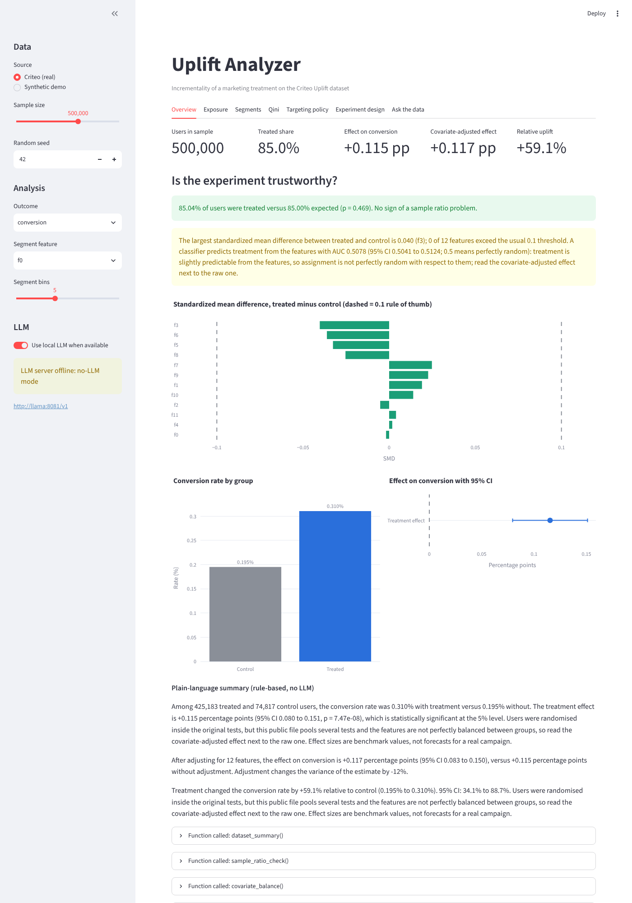
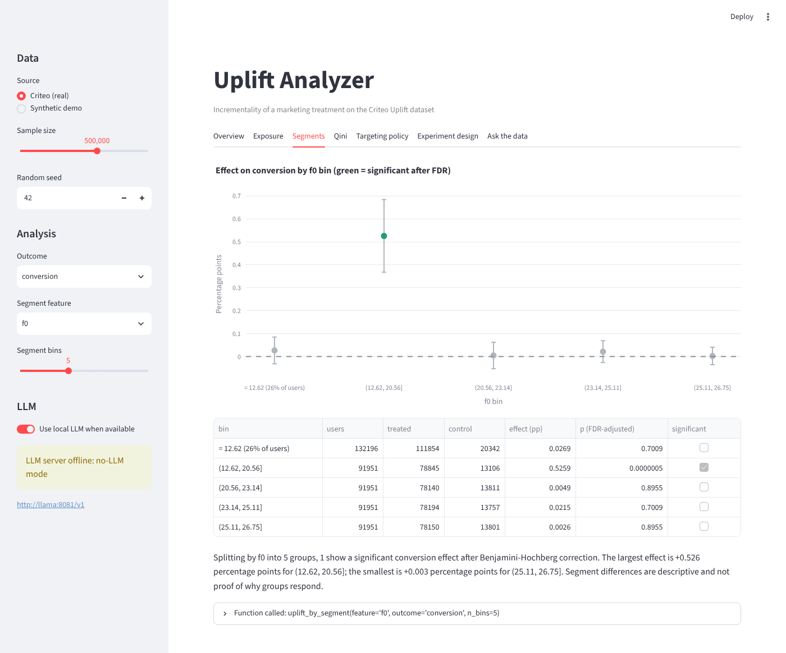
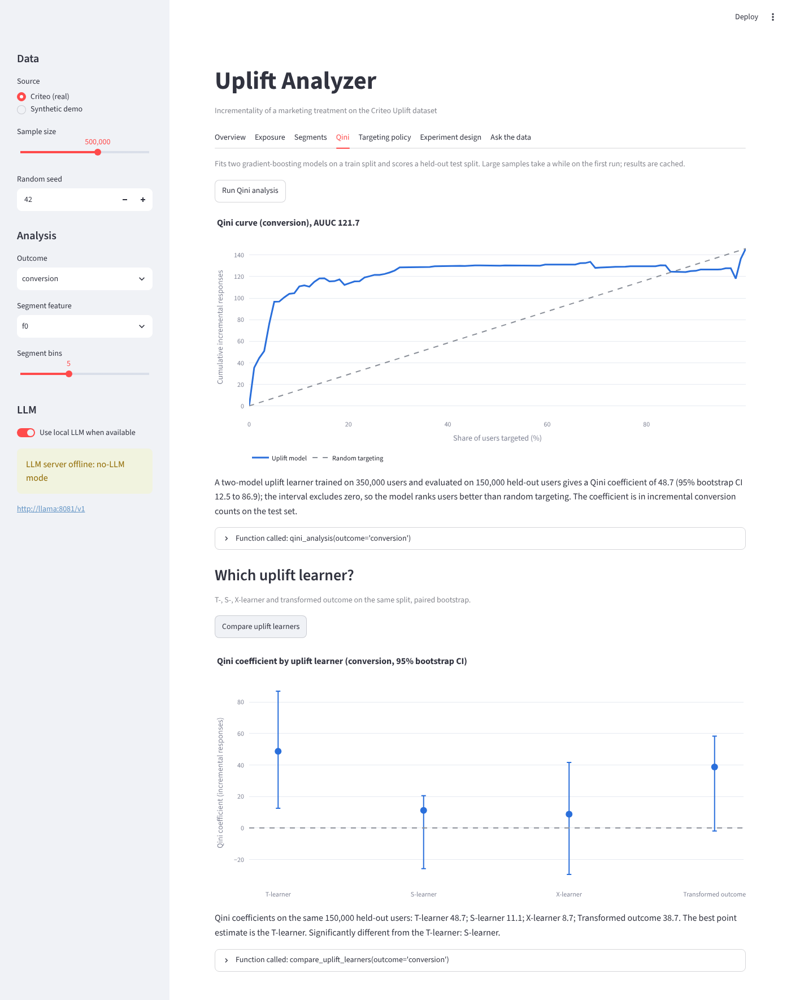
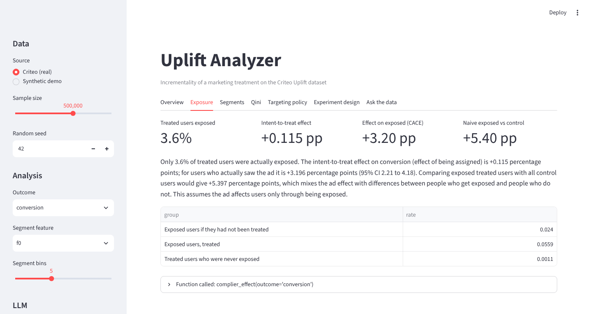
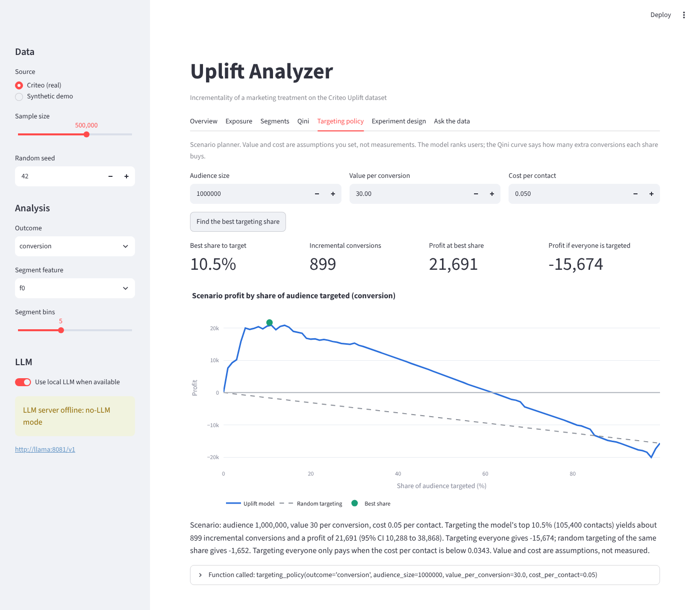
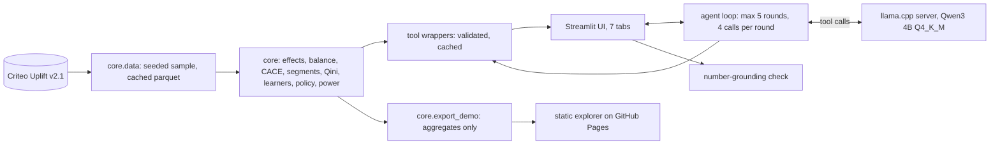
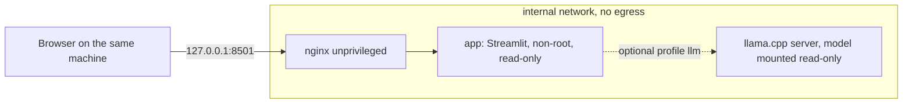

# uplift-analyzer

[](https://github.com/dbechrakis/uplift-analyzer/actions/workflows/ci.yml)
[](https://github.com/dbechrakis/uplift-analyzer/actions/workflows/llm-eval.yml)


Local-first analytics that measures the **incrementality (uplift)** of a marketing treatment on the
[Criteo Uplift Prediction dataset](https://huggingface.co/datasets/criteo/criteo-uplift) (13.98M users from randomized incrementality tests),
and a small **local LLM** that explains the results in plain business language without ever computing a number.
Zero spend: open data, open-source tools, no cloud, no paid APIs.

**[Open the interactive explorer](https://dbechrakis.github.io/uplift-analyzer/)** (static page, aggregate results only) · [Validation record](VALIDATION.md) · [Run the app locally](#quick-start)



## Decision in 60 seconds

| Question | Evidence | Decision supported | Boundary |
|---|---|---|---|
| Did the treatment cause extra visits and conversions, for whom, and is targeting worth it? | On all 13,979,592 users the raw effect is **+0.115 pp on conversion (+59%)** and **+1.03 pp on visits (+27%)**; adjusting for the features gives +0.100 and +0.773 pp. Only **3.6%** of treated users were exposed, so the effect on users who actually saw the ad is **+3.2 pp** (conversion) and **+28.7 pp** (visit). | Where to look for responders, whether blanket targeting pays, and how big the next test must be. In a scenario of 30 per conversion and 0.05 per contact, targeting everyone loses 15.7k per million users while the model's best 10.5% earns 21.7k. | The file pools several tests and was sub-sampled by Criteo, so effects are benchmark values, not forecasts. Assignment is slightly predictable from the features. Profit is a scenario with assumed value and cost. |

## Why this project is different

* **Statistics that check themselves.** Sample ratio check, covariate balance with a classifier-based joint test, regression adjustment, Benjamini-Hochberg across segments, delta-method intervals, bootstrap intervals on Qini. [VALIDATION.md](VALIDATION.md) records each check, including the defects verification found and the fixes.
* **A real finding about the data.** The treatment is slightly predictable from the features (AUC 0.508, interval excludes 0.5) even though the sample ratio check passes, and the raw and adjusted effects disagree on the full data. The app shows both and says so.
* **Intent-to-treat versus exposed.** Because only 3.6% of treated users saw the ad, the headline effect hides a 28.7 pp effect on visits among exposed users. A naive "exposed versus control" comparison would overstate it (+38.6 pp on the 500k sample); the instrumental-variable estimate does not.
* **From effect to decision.** Qini curve, four uplift learners compared with paired bootstrap, a profit-maximizing targeting share, and a sample-size and minimum-detectable-effect planner.
* **The LLM never computes a number.** It chooses one of eleven validated functions through tool calling, the code computes, and the UI always shows the function called and its raw JSON. A number-grounding check flags any figure in an explanation that is not in a tool result.
* **Hardened and verified deployment:** non-root, read-only containers, `cap_drop: ALL`, an internal network with no egress, a localhost-only port, digest-pinned images, hash-pinned dependencies, `pip-audit` and Trivy in CI.

## Findings

All-users figures come from a streaming pass over the full file; model-based results (Qini, learners, policy) use the seeded 500,000-user sample, split 70/30 into train and held-out test.

| All 13,979,592 users | Conversion | Visit |
|---|---|---|
| Control to treated rate | 0.194% to 0.309% | 3.82% to 4.85% |
| Raw effect (95% CI) | +0.115 pp (0.109 to 0.122) | +1.034 pp (1.006 to 1.063) |
| Covariate-adjusted effect | +0.100 pp | +0.773 pp |
| Effect on exposed users (CACE, 95% CI) | +3.20 pp (3.01 to 3.38) | +28.7 pp (27.9 to 29.5) |

**1. The experiment is nearly, not perfectly, randomized.** 85.00% of users are treated, as designed (p = 0.999), and no standardized difference exceeds 0.05. But a classifier predicts treatment from the features with AUC 0.5078 (95% CI 0.5041 to 0.5120), and the adjusted visit effect is 25% smaller than the raw one. Read the adjusted estimate next to the raw one.

**2. Most of the effect lives in a few users.** On seven of the twelve features, 82% to 99% of users share a single default value; where that group shows a significant effect it is small (conversion +0.05 to +0.10 pp). Small groups with non-default values show much larger effects (up to about +5 pp on conversion in groups of a few thousand users, FDR-adjusted).

**3. A model can find them.** The held-out Qini coefficient is 531 (95% CI 386 to 677) for visits and 49 (11 to 86) for conversions. For conversions, the model's top 10% of users captures 75% of all incremental conversions and the top 30% captures 88%. The simple two-model T-learner is not beaten: for conversions the S-learner is significantly worse, and no other learner differs significantly.

**4. Targeting is a scenario, and the break-even is low.** Targeting everyone only pays when a contact costs less than 0.034 per user (value 30 per conversion). Below that, blanket targeting is profitable; above it, only a model-selected subset is.

**5. Detecting a 10% relative conversion lift at the original 85% treated share would need about 3.35 million users.** The observed +59% is far easier to detect than the lifts most real tests chase.

| Segments | Qini and learners |
|---|---|
|  |  |

| Exposure (ITT versus CACE) | Targeting policy |
|---|---|
|  |  |

## Architecture



Deployment topology (`deploy/docker-compose.yml`):



## Quick start

```bash
make install
.venv/bin/python -m core.data --download      # 311 MB, SHA-256 verified
make run                                      # Streamlit on http://localhost:8501
```

No dataset yet? Pick "Synthetic demo" in the sidebar (clearly labeled, never mixed with real results).
Manual download: save the file from
`https://huggingface.co/datasets/criteo/criteo-uplift/resolve/main/criteo-research-uplift-v2.1.csv.gz`
as `data/raw/criteo-research-uplift-v2.1.csv.gz`.

**Sampling.** The app analyses a seeded random sample, default **500,000 rows** (`UPLIFT_SAMPLE_SIZE`, `UPLIFT_SEED`), exact, reproducible and cached as parquet. `make validate` streams all rows to produce [the validation record](VALIDATION.md).

**With the LLM.** Install [llama.cpp](https://github.com/ggml-org/llama.cpp), fetch the model and start the server with tool calling enabled:

```bash
make fetch-model
llama-server -m models/Qwen3-4B-Instruct-2507-Q4_K_M.gguf --jinja --host 127.0.0.1 --port 8080 -c 8192
```

`LLAMA_BASE_URL` and `LLAMA_MODEL_PATH` come from the environment (see `.env.example`). The app detects the server and falls back to a fully working no-LLM mode when it is down.

**With Docker.**

```bash
make docker-up          # app + nginx
make docker-up-llm      # adds the llama.cpp server (downloads the model first)
```

Open http://127.0.0.1:8501. The containers cannot reach the internet, so fetch the dataset and model on the host first (`./data` and `./models` are mounted into them).

## Core functions

| Function | What it returns |
|---|---|
| `average_treatment_effect` | rate difference, 95% CI (unpooled Wald), two-proportion z-test p-value (pooled) |
| `regression_adjusted_effect` | Lin (2013) interacted OLS with robust errors, and the variance change versus the raw estimate |
| `relative_uplift` | lift versus control with delta-method CI on the log risk ratio |
| `complier_effect` | intent-to-treat, effect on exposed users (Wald IV, delta-method CI), complier and never-taker rates, naive comparison |
| `covariate_balance` | standardized differences per feature and a classifier AUC with bootstrap CI |
| `sample_ratio_check` | chi-square test of the treatment share (default 0.85) |
| `uplift_by_segment` | per-bin effect (dominant values get their own bin) with Benjamini-Hochberg adjusted p-values |
| `qini_analysis` | T-learner, Qini curve, AUUC, bootstrap CI |
| `compare_uplift_learners` | T-, S-, X-learner and transformed outcome with paired bootstrap differences (UI only) |
| `targeting_policy` | best targeting share and profit for a value and cost scenario, with a bootstrap interval |
| `required_sample_size` / `minimum_detectable_effect` | users needed for a relative lift, or the lift a sample can detect |
| `dataset_summary` | row count, treated share, base rates |

Every function returns a frozen dataclass that is JSON serializable and carries a `data_source` field (`criteo`, `synthetic`, `constructed`).

## LLM evaluation

`make eval` runs 61 questions against the live model, three times, and scores tool choice, arguments, whether an answer was produced, and number grounding. A weekly workflow repeats it in CI against the real model with a regression gate.
Qwen3-4B-Instruct-2507 Q4_K_M on llama.cpp, CPU only (4 cores), 100k-row real sample.

EVAL_TABLE

## Security and hardening

Verified on a running stack, not just written down:

* Containers run as non-root (`10001` for the app and the model server, `101` for nginx), `CapEff` is empty, `no-new-privileges` is on, root filesystems are read-only, with PID and memory limits.
* App and LLM sit on an `internal: true` network (no DNS, no internet). Only nginx also joins an edge network, and it publishes to `127.0.0.1` only. nginx adds security headers, rate limiting that exempts static assets, and websocket proxying.
* Dependencies are pinned with hashes and installed with `uv pip sync --require-hashes`; the image build runs `pip-audit --strict`. Base images are pinned by digest.
* CI: ruff, pytest with a coverage gate, `pip-audit`, hadolint, Trivy image and configuration scans, a compose smoke test with a 300-request asset burst, plus the weekly LLM evaluation. Actions are pinned to commit SHAs with read-only permissions; Dependabot keeps pip, Actions and Docker current.
* Local Trivy scan of the built image: 0 HIGH or CRITICAL findings. See `SECURITY.md`.

## Project layout

```
core/        data, effects, balance, CACE, segments, Qini, learners, policy, power, validation, demo export
app/         Streamlit UI, llama.cpp client, tool definitions, agent loop, evaluation harness
demo/        static explorer for GitHub Pages (aggregate data only)
deploy/      Dockerfile, docker-compose, nginx config, model fetch script
tests/       offline tests: known answers, simulations, statsmodels equivalence, mocked LLM server
evals/       61 tool-selection cases and recorded runs
outputs/     validation.json from the full-data pass
.github/     CI, Pages, LLM evaluation, Dependabot
```

## Limitations

* **Benchmark, not a forecast.** The public file pools several incrementality tests and was sub-sampled non-uniformly by Criteo, so the true incrementality level cannot be recovered. Effect sizes must not be used to predict a real campaign.
* **Randomization is imperfect.** Assignment is slightly predictable from the features. Adjustment corrects for observed features only; unobserved imbalance would remain. Qini and policy results use the raw labels and inherit this.
* **The complier analysis rests on an untestable assumption:** the ad affects users only through being exposed.
* **The targeting profit is a scenario** with assumed value and cost, and the optimum is chosen on the same held-out users, so it is slightly optimistic. Targeting is not a claim about any real campaign.
* **Samples, not the full data, drive the model results.** Segment groups with non-default feature values are small, so their intervals are wide.
* **Small-model caveats.** A 4B local model can pick a different but defensible tool, skip a tool call, or misstate a number; the grounding check catches numbers absent from tool output but not wrong interpretations of correct numbers. In the screenshot above the model called the right tool with the right arguments, then described the break-even cost slightly loosely. It is slow on CPU (tens of seconds per answer). The evaluation has 61 questions and indicates behaviour; it is not a benchmark.
* The uplift learners use default hyperparameters; they are baselines, not tuned production models.
* The app has no authentication; keep it bound to localhost.

## Data license and citation

The Criteo Uplift dataset is released under **CC BY-NC-SA 4.0 (non-commercial)** and is not redistributed here; the static explorer publishes aggregate results only. Please cite:
Diemert, Betlei, Renaudin, Amini. *A Large Scale Benchmark for Uplift Modeling*. AdKDD 2018 Workshop, KDD 2018.

Code license: MIT.
