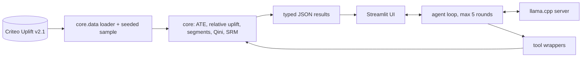

# uplift-analyzer

Local-first analytics that measures the **incrementality (uplift)** of a marketing treatment on the
[Criteo Uplift Prediction dataset](https://ailab.criteo.com/criteo-uplift-prediction-dataset/),
with a small local LLM that explains results in plain business language.

> Status: core statistics and the Streamlit app (with optional local LLM) are complete. Docker and CI land in Phase 3.

## Architecture



The LLM never computes numbers. Every statistic comes from `core/`; the model only explains a returned result.

## Data and sampling

* Source: Criteo Uplift v2.1 (13,979,592 rows, features `f0`-`f11`, `treatment`, `conversion`, `visit`, `exposure`), randomized experiment with about 85% treated.
* The raw file is **not** committed. Get it with `python -m core.data --download` (311 MB, SHA-256 verified) or save it manually as `data/raw/criteo-research-uplift-v2.1.csv.gz` from
  `https://huggingface.co/datasets/criteo/criteo-uplift/resolve/main/criteo-research-uplift-v2.1.csv.gz`.
* Analyses run on a **seeded random sample, default 500,000 rows** (`UPLIFT_SAMPLE_SIZE`, `UPLIFT_SEED`). The sample is exact, reproducible and cached as parquet.
* `core/synthetic.py` generates same-schema **synthetic** data for tests and demos only. Every result carries a `data_source` field (`criteo`, `synthetic`, `constructed`), so synthetic output is never mistaken for real.

## Core functions

| Function | What it returns |
|---|---|
| `average_treatment_effect` | rate difference, 95% CI (unpooled Wald), two-proportion z-test p-value |
| `relative_uplift` | lift vs control with delta-method CI on the log risk ratio |
| `uplift_by_segment` | per-quantile-bin effect with Benjamini-Hochberg adjusted p-values |
| `qini_analysis` | T-learner (gradient boosting), Qini curve, AUUC, bootstrap CI |
| `sample_ratio_check` | chi-square test of the treatment share (default 0.85) |

## App

```bash
.venv/bin/python -m streamlit run app/main.py
```

Tabs: Overview, Segments, Qini, Ask the data. The sidebar sets source, sample size, outcome and segment feature.
Every analysis shows the function that was called and its raw JSON in an expander.


**No-LLM mode.** With the server off, the app stays fully usable: all tabs work, and "Ask the data" becomes a function picker with a rule-based plain-language explanation next to the raw result.

**LLM mode.** Start a llama.cpp server with a ~4B instruct GGUF (Q4_K_M, for example a Qwen3 4B Instruct build) and tool calling enabled:

```bash
llama-server -m "$LLAMA_MODEL_PATH" --jinja --host 127.0.0.1 --port 8080 -c 8192
```

`LLAMA_BASE_URL` (default `http://127.0.0.1:8080/v1`) and `LLAMA_MODEL_PATH` come from the environment (see `.env.example`).
The model picks one of six core functions through OpenAI-style tool calling, the code computes, and the model only explains the returned result.
The loop is capped at 5 rounds and at 4 tool calls per round. Any number in the explanation that does not appear in a tool result is flagged in the UI.

## Run

```bash
uv venv --python 3.12 .venv
uv pip install --python .venv/bin/python --require-hashes -r requirements-dev.txt
.venv/bin/python -m core.data --download
.venv/bin/python -m core.report --compact
.venv/bin/python -m pytest
```

## Sample result (500k rows, seed 42, real data)

| Outcome | Control | Treated | ATE (95% CI) | Relative uplift (95% CI) |
|---|---|---|---|---|
| visit | 3.67% | 4.87% | +1.19 pp (1.04 to 1.34) | +32% (27 to 38) |
| conversion | 0.20% | 0.31% | +0.115 pp (0.080 to 0.151) | +59% (34 to 89) |

Sample ratio check passes (p = 0.47). Conversion is rare, so its intervals are wide.

## Limitations

* Results come from a 500k sample, not the full 14M rows; intervals on `conversion` are wide.
* A 4B local model can pick the wrong tool or phrase things loosely; the raw result and the number check are there to catch that.
* Uplift models rank users; they do not by themselves prove why a segment responds.
* Causal claims hold only for the randomized treatment-versus-control comparison in this experiment.
