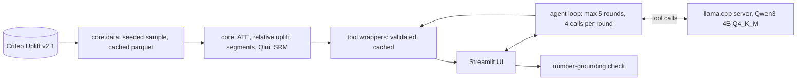
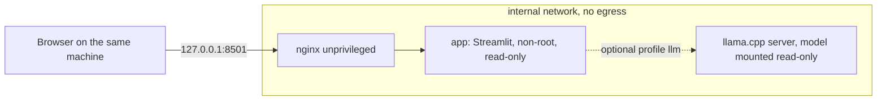

# uplift-analyzer

[](https://github.com/dbechrakis/uplift-analyzer/actions/workflows/ci.yml)


Local-first analytics that measures the **incrementality (uplift)** of a marketing treatment on the
[Criteo Uplift Prediction dataset](https://huggingface.co/datasets/criteo/criteo-uplift) (13.98M users from randomized incrementality tests),
with a small **local LLM** that explains the results in plain business language.
Zero spend: open data, open-source tools, no cloud, no paid APIs.


## Why this project is different

* **The LLM never computes a number.** It only picks one of six validated core functions through tool calling. The code computes, and the model explains the returned result. The UI always shows which function was called and its raw JSON.
* **A number-grounding check** flags any figure in the model's explanation that is not in a tool result. On a real 4B model it caught a wrong conversion rate that sounded plausible (see [LLM evaluation](#llm-evaluation)).
* **Statistics done properly:** sample ratio check, two-proportion z-test, delta-method CI on relative uplift, Benjamini-Hochberg correction across segments, Qini/AUUC with a bootstrap confidence interval.
* **Fully usable without the LLM:** every tab works with the server off, with rule-based explanations next to the raw results.
* **Hardened deployment, verified:** non-root, read-only containers, `cap_drop: ALL`, internal network with no egress, localhost-only port, hash-pinned dependencies, `pip-audit` and Trivy in CI.

## Findings on real data (500,000-user sample, seed 42)

| Outcome | Control | Treated | Effect (95% CI) | Relative uplift (95% CI) |
|---|---|---|---|---|
| visit | 3.67% | 4.87% | +1.19 pp (1.04 to 1.34) | +32% (27 to 38) |
| conversion | 0.195% | 0.310% | +0.115 pp (0.080 to 0.151) | +59% (34 to 89) |

* Sample ratio check passes: 85.04% treated versus the designed 85% (p = 0.47).
* Both effects are statistically significant, but conversion is rare (about 0.29%), so its intervals are wide.
* The uplift model separates responders from the rest: Qini coefficient 531 (95% CI 386 to 677) for visits and 49 (11 to 86) for conversions, both intervals excluding zero. Targeting the top 10% of users ranked by the model captures 76% of all incremental conversions, and the top 30% captures 87%.
* Effects concentrate in the lowest `f0` bin: +0.24 pp on conversion versus about zero in the top bin (significant after FDR correction).

| Segments | Qini |
|---|---|
|  |  |

## Architecture



Deployment topology (`deploy/docker-compose.yml`):



## Quick start

```bash
make install
.venv/bin/python -m core.data --download      # 311 MB, SHA-256 verified
make run                                      # Streamlit on http://localhost:8501
```

No dataset yet? Pick "Synthetic demo" in the sidebar (clearly labeled, never mixed with real results).
Manual download: save the file from
`https://huggingface.co/datasets/criteo/criteo-uplift/resolve/main/criteo-research-uplift-v2.1.csv.gz`
as `data/raw/criteo-research-uplift-v2.1.csv.gz`.

**Sampling.** Analyses run on a seeded random sample, default **500,000 rows** (`UPLIFT_SAMPLE_SIZE`, `UPLIFT_SEED`). The sample is exact, reproducible and cached as parquet.

**With the LLM.** Install [llama.cpp](https://github.com/ggml-org/llama.cpp), fetch the model and start the server with tool calling enabled:

```bash
make fetch-model
llama-server -m models/Qwen3-4B-Instruct-2507-Q4_K_M.gguf --jinja --host 127.0.0.1 --port 8080 -c 8192
```

`LLAMA_BASE_URL` and `LLAMA_MODEL_PATH` come from the environment (see `.env.example`). The app detects the server automatically and falls back to no-LLM mode when it is down.

**With Docker.**

```bash
make docker-up          # app + nginx, synthetic demo or your ./data
make docker-up-llm      # adds the llama.cpp server (downloads the model first)
```

Open http://127.0.0.1:8501. The containers cannot reach the internet, so fetch the dataset and model on the host first (`./data` and `./models` are mounted into them).

## Core functions

| Function | What it returns |
|---|---|
| `average_treatment_effect` | rate difference, 95% CI (unpooled Wald), two-proportion z-test p-value (pooled) |
| `relative_uplift` | lift versus control with delta-method CI on the log risk ratio |
| `uplift_by_segment` | per-quantile-bin effect with Benjamini-Hochberg adjusted p-values |
| `qini_analysis` | T-learner (two gradient-boosting models), Qini curve, AUUC, bootstrap CI |
| `sample_ratio_check` | chi-square test of the treatment share (default 0.85) |
| `dataset_summary` | row count, treated share, base rates |

Every function returns a frozen dataclass that is JSON serializable and carries a `data_source` field (`criteo`, `synthetic`, `constructed`).

## LLM evaluation

`make eval` runs 20 questions against the live model and scores tool choice, arguments, whether an answer was produced, and number grounding.
Real runs on CPU only (4 cores), Qwen3-4B-Instruct-2507 Q4_K_M, 100k-row real sample:

| Metric | Run 1 | Run 2 |
|---|---|---|
| Right function chosen first | 80% | 90% |
| Right arguments | 90% | 90% |
| Answer produced | 100% | 100% |
| All numbers grounded in tool output | 75% | 80% |
| Median seconds per answer | 36.8 | 27.2 |

What the failures looked like (all recorded in `evals/results*.json`):

* Run 1: for "how many users are in the sample?" the model asked for more data instead of calling `dataset_summary`. A stricter system prompt fixed both such cases in run 2.
* Run 2: the model reported an absolute effect of 0.00192 as "+192 basis points" (it is 19.2) and 0.19 pp as "+1.92%". These are 10x misstatements of correct tool output, and the grounding check flagged them.
* "If we only target part of the audience, how much incremental conversion do we keep?" is ambiguous; the model chose a segment breakdown in run 1 and no tool in run 2. The Qini tool was expected.
* Off-topic and prompt-injection questions never triggered a tool call or an invented number.


Takeaways: the small model usually picks the right function, but it can phrase numbers loosely or skip a tool call, which is exactly why the raw result and the grounding check are always shown. The second run changed only the system prompt and the grounding rule for true `p < x` bounds, after reading the failures of the first; with 20 cases the figures are indicative, not a benchmark.

## Security and hardening

Verified on a running stack, not just written down:

* Containers run as non-root (`10001` for the app, `101` for nginx), `CapEff` is empty, `no-new-privileges` is on, the root filesystem is read-only, with PID and memory limits.
* App and LLM sit on an `internal: true` network (no DNS, no internet). Only nginx also joins an edge network, and it publishes to `127.0.0.1` only. nginx adds security headers, rate limiting and websocket proxying.
* Dependencies are pinned with hashes and installed with `uv pip sync --require-hashes`; the image build runs `pip-audit --strict` and fails on known vulnerabilities.
* CI (`.github/workflows/ci.yml`): ruff, pytest with a coverage gate, `pip-audit`, hadolint, Trivy image and configuration scans, and a compose smoke test, weekly and on every push. Actions are pinned to commit SHAs with read-only permissions. Dependabot keeps pip, Actions and Docker current.
* Local Trivy scan of the built image: 0 HIGH or CRITICAL findings. See `SECURITY.md`.

## Project layout

```
core/        data loading, uplift metrics, segments, statistical tests, report script
app/         Streamlit UI, llama.cpp client, tool definitions, agent loop, evaluation
deploy/      Dockerfile, docker-compose, nginx config, model fetch script
tests/       offline tests with known answers and a mocked LLM server
evals/       tool-selection cases and recorded results
.github/     CI workflow and Dependabot config
```

## Limitations

* **Benchmark, not a forecast.** The public dataset pools several incrementality tests and was sub-sampled non-uniformly by Criteo, so the true incrementality level cannot be recovered. Effect sizes here are benchmark values and must not be used to predict a real campaign.
* **Sample, not the full data.** Results come from a 500k-user sample of 14M rows; conversion intervals are wide.
* **Causal claims stop at the randomized comparison** of treated versus control in this experiment. Segment differences and uplift rankings are descriptive and do not explain why users respond.
* **Small-model caveats.** A 4B local model can pick a different but defensible tool, skip a tool call, or misstate a number; the grounding check catches numbers absent from tool output but not wrong interpretations of correct numbers. It is slow on CPU (tens of seconds per answer).
* The uplift model is a plain T-learner with default hyperparameters, a baseline rather than a tuned production model.
* The app has no authentication; keep it bound to localhost.
* Docker image tags (`python:3.12-slim`, `nginx-unprivileged`, `llama.cpp:server`) are not digest-pinned; pin digests for production.

## Data license and citation

The Criteo Uplift dataset is released under **CC BY-NC-SA 4.0 (non-commercial)** and is not redistributed here. Please cite:
Diemert, Betlei, Renaudin, Amini. *A Large Scale Benchmark for Uplift Modeling*. AdKDD 2018 Workshop, KDD 2018.

Code license: MIT.
